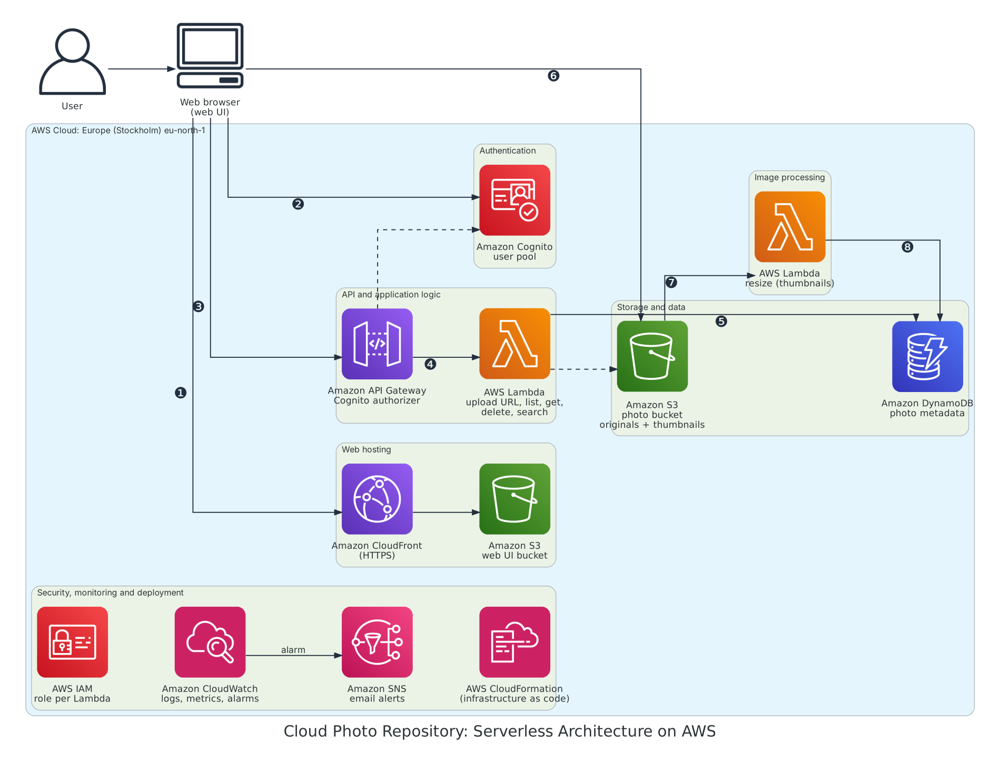

# Cloud Photo Repository

A serverless photo library on AWS. Signed-in users upload, browse, search and delete their own photos. Photos are stored in Amazon S3, an AWS Lambda function creates thumbnails, and Amazon DynamoDB stores each photo's details. Cloud Computing course project.



## Team and ownership

| Member | Role | Folder / section |
| --- | --- | --- |
| 1 | Architecture and integration | `template.yaml` structure, `docs/`, `scripts/`, final integration and end-to-end testing |
| 2 | Frontend and content delivery | `frontend/`, template section "Member 2" |
| 3 | Backend and API | `backend/`, template section "Member 3" |
| 4 | Storage, database and image processing | `storage-processing/`, template section "Member 4" |
| 5 | Security and networking | `security/`, template section "Member 5" |
| 6 | Monitoring, testing and cost | `monitoring/`, template section "Member 6" |

Each folder has a short README with that member's tasks from the team plan.

## Services in the architecture

| Layer | Service |
| --- | --- |
| Entry and hosting | Amazon CloudFront, Amazon S3 (web UI) |
| Identity | Amazon Cognito |
| API | Amazon API Gateway |
| Compute | AWS Lambda (API functions, resize function) |
| Storage and data | Amazon S3 (photos), Amazon DynamoDB |
| Security | AWS IAM |
| Monitoring | Amazon CloudWatch, Amazon SNS |
| Deployment | AWS CloudFormation (this repo's `template.yaml`) |

## How we work

1. **Branch per task:** `git checkout -b m3/api-routes` (your member number + topic).
2. Add your resources to **your section** of `template.yaml` and your code to **your folder**.
3. Push and open a **pull request**.  merges and deploys.
4. Never commit passwords, access keys or `.env` files.

## Deploy 


```bash
aws login
export AWS_REGION=eu-north-1
bash scripts/deploy.sh photo-repo
```

## Testing

The end-to-end test plan is in [docs/e2e-test-checklist.md](docs/e2e-test-checklist.md). Member 1 runs it once every member's part is merged and deployed.

## Status

- Architecture, repository structure, deployment script and AWS account: done .

